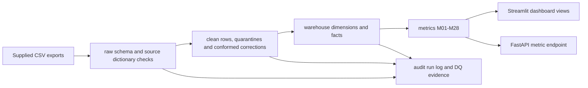

# Metric lineage and API contract

## End-to-end path

`raw` is retained as source evidence. `clean` applies type, nullability, identifier and feed-specific rules; quarantined rows retain a JSON copy, source table, row number and reason. Documented SCD and ledger corrections are recorded in audit tables. The warehouse links time-variant employee facts through `employee_key`. The API reads only the governed metric catalog and views.

## Five API metrics

| ID | Metric | View and formula | Source and grain | Owner / privacy |
|---|---|---|---|---|
| M01 | Headcount | `metrics.m01_headcount`; distinct active employees at month end | `fact_headcount_monthly` and `dim_employee`; department x month | HR Analytics; minimum group size 5 |
| M04 | Monthly attrition | `metrics.m04_attrition_monthly`; exits / starting headcount x 100 | `fact_headcount_monthly`; department x month | HR Analytics; minimum group size 10 |
| M09 | Employer payroll cost | `metrics.m09_payroll_cost`; sum of employer cost | `fact_payroll`; employee x month, rolled up by department | Finance; minimum group size 5 |
| M20 | Days sales outstanding | `metrics.m20_dso`; closing receivables / trailing 90-day revenue including GST x 90 | `fact_invoice` and `fact_ledger`; month | Finance; no employee data |
| M22 | Task completion | `metrics.m22_task_completion`; Done / non-Cancelled tasks x 100 | `fact_task`; team x sprint | Engineering Ops; minimum group size 5 |

The API includes each metric's dictionary definition, source, formula, owner, unit, grain, caveat, minimum group size, observed data cutoff and privacy note. Unknown metric IDs and invalid month parameters return HTTP 4xx errors. OpenAPI is generated from FastAPI at `/docs`.

## Freshness and limits

The latest successful local ETL run is shown in `metrics.dashboard_data_freshness`; the source data cutoff is 2026-09-30. The static training extract does not contain new monthly deliveries, so a scheduled refresh cannot advance the cutoff without a new source file. M28 has 66 forecast rows and no measured forecast-error values because actuals end in September 2026 and projections begin in October 2026.
