# PulseIQ star-schema join map

```mermaid
erDiagram
  DIM_DATE ||--o{ FACT_HEADCOUNT_MONTHLY : date_key
  DIM_DEPARTMENT ||--o{ FACT_HEADCOUNT_MONTHLY : department_id
  DIM_DATE ||--o{ FACT_PAYROLL : date_key
  DIM_EMPLOYEE ||--o{ FACT_PAYROLL : employee_key
  DIM_DEPARTMENT ||--o{ FACT_PAYROLL : department_id
  DIM_ROLE ||--o{ FACT_PAYROLL : role_id
  DIM_ACCOUNT ||--o{ FACT_LEDGER : account_code
  DIM_DEPARTMENT ||--o{ FACT_LEDGER : cost_center_department_id
  DIM_DATE ||--o{ FACT_LEDGER : date_key
  DIM_CLIENT ||--o{ FACT_INVOICE : client_id
  DIM_ACCOUNT ||--o{ FACT_INVOICE : service_line_account
  DIM_DATE ||--o{ FACT_INVOICE : invoice_date_key
  FACT_INVOICE ||--o{ FACT_INVOICE_PAYMENT : invoice_id
  DIM_DATE ||--o{ FACT_INVOICE_PAYMENT : payment_date_key
  DIM_VENDOR ||--o{ FACT_EXPENSE : vendor_id
  DIM_ACCOUNT ||--o{ FACT_EXPENSE : category_account
  DIM_DEPARTMENT ||--o{ FACT_EXPENSE : department_id
  DIM_DATE ||--o{ FACT_EXPENSE : expense_date_key
  DIM_LOCATION ||--o{ DIM_EMPLOYEE : work_location
  DIM_DATE ||--o{ FACT_ATTENDANCE_MONTHLY : date_key
  DIM_DATE ||--o{ FACT_LEAVE : start_date_key
  DIM_DATE ||--o{ FACT_LEAVE : end_date_key
  DIM_EMPLOYEE ||--o{ FACT_ATTENDANCE_MONTHLY : employee_key
  DIM_DEPARTMENT ||--o{ FACT_ATTENDANCE_MONTHLY : department_id
  DIM_EMPLOYEE ||--o{ FACT_LEAVE : employee_key
  DIM_LEAVE_TYPE ||--o{ FACT_LEAVE : leave_type_code
  DIM_TEAM ||--o{ FACT_TASK : team_id
  DIM_SPRINT ||--o{ FACT_TASK : sprint_id
  DIM_EMPLOYEE ||--o{ FACT_TASK : assignee_employee_id
  DIM_EMPLOYEE ||--o{ FACT_ANOMALY : employee_id
  DIM_DATE ||--o{ FACT_ANOMALY : period_key
  DIM_EMPLOYEE ||--o{ FACT_ATTRITION_RISK : employee_key
  DIM_DEPARTMENT ||--o{ FACT_ATTRITION_RISK : department_id
  DIM_DATE ||--o{ FACT_ATTRITION_RISK : as_of_date_key
  DIM_DEPARTMENT ||--o{ FACT_FORECAST : department_id
  DIM_DATE ||--o{ FACT_FORECAST : forecast_month_key
```

`dim_employee.employee_key` is the surrogate key for a version of a person. Facts carrying this key join to the version valid for that period. June payroll for a person who moved in July remains assigned to the June department version; July facts use the new version. `employee_id` identifies the person across versions and is used for person-level distinct counts.

The warehouse materializes source fact and dimension shapes as tables with declared primary keys. `audit.orphan_results` checks each delivered fact-to-dimension relationship and reports unmatched keys without silently rewriting source rows.
